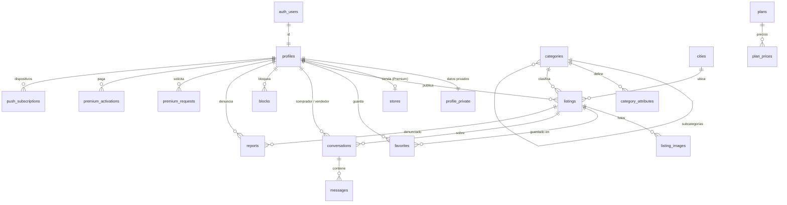

# Modelo de datos — BKLN Marketplace

> Versión 1.0 — 2026-10-16. Diseño del MVP y especificación de las migraciones de `supabase/migrations/`.
> Postgres 17 (Supabase). Tablas y columnas en inglés; las explicaciones, en español.

---

## 1. Principios

- **Supabase Auth** gestiona `auth.users` (email + contraseña). El resto vive en el esquema `public`.
- **RLS en todas las tablas.** Lo que el cliente no debe hacer directamente pasa por funciones `security definer` (RPC) o por el servidor con la clave secreta.
- **Los datos públicos y los privados del usuario van en tablas separadas**: `profiles` es pública y `profile_private` solo la leen su dueño y el admin. RLS filtra filas, no columnas, y el teléfono no debe poder leerse nunca desde fuera.
- **Permisos por columna** (`GRANT UPDATE (col, …)`) además de RLS: un usuario puede editar el título de su anuncio, pero no su estado ni su `premium_until`.
- **Las reglas críticas se aplican en la base de datos**: límites de plan, email confirmado para publicar, cambios de estado, bloqueos y umbral de reportes.
- **La configuración vive en tablas** (`plans`, `plan_prices`, `app_settings`), no en el código.
- **Dinero:** `bigint`/`integer` en XAF, sin decimales. **Fechas:** `timestamptz`, mostradas en `Africa/Malabo`.
- **Los anuncios no se borran físicamente** (`status = 'deleted'`). El borrado físico solo ocurre al eliminar una cuenta (§11).
- Para listas de valores estables se usan enums de Postgres. Sus textos visibles van en i18n, no en la base de datos.

## 2. Diagrama

## 3. Tablas

### 3.1 Usuarios

**`profiles`**: datos públicos. Se crea con un trigger al registrarse (§5.1).

| Columna | Tipo | Notas |
|---|---|---|
| `id` | `uuid` PK | → `auth.users(id)`, se borra en cascada |
| `username` | `text` único | `^[a-z][a-z0-9._]{2,19}$`, en minúsculas; no puede estar en la lista de reservados |
| `display_name` | `text` | 2–50 caracteres |
| `avatar_path` | `text` null | Ruta en el bucket `profile-media` |
| `city_id` | `smallint` null | → `cities` |
| `bio` | `text` null | Máximo 300 caracteres |
| `premium_until` | `timestamptz` null | **Es Premium si `premium_until > now()`.** Solo lo cambia el RPC del admin |
| `response_time_minutes` | `integer` null | Mediana de la primera respuesta; se recalcula a diario (§10) |
| `status` | `account_status` | `active` · `suspended` · `banned` |
| `created_at`, `updated_at` | `timestamptz` | "Miembro desde" = `created_at` |

**`profile_private`**: solo el dueño y el admin.

| Columna | Tipo | Notas |
|---|---|---|
| `user_id` | `uuid` PK | → `profiles`, en cascada |
| `phone` | `text` único | `^\+240[0-9]{9}$`, normalizado |
| `phone_verified_at` | `timestamptz` null | Fase 2 (OTP) |
| `email_verified_at` | `timestamptz` null | Verificación propia (D-020). Se pone a null si cambia el email |
| `show_whatsapp` | `boolean` | Por defecto `false` (D-005) |
| `role` | `user_role` | `user` · `admin` |
| `suspended_until` | `timestamptz` null | Suspensión temporal |
| `notify_push`, `notify_email` | `boolean` | Preferencias de notificación, `true` por defecto |
| `updated_at` | `timestamptz` | |

El email no se duplica aquí: vive en `auth.users` y solo lo leen las funciones del servidor.

**`stores`**: tienda Premium (1:1 con el perfil). Los datos se conservan si caduca Premium (ALCANCE §5.3).

| Columna | Tipo | Notas |
|---|---|---|
| `user_id` | `uuid` PK | → `profiles`, en cascada |
| `slug` | `text` único | URL `/t/<slug>`. 3–40 caracteres: minúsculas, números y guiones; empieza por letra. Por defecto, el username con puntos y guiones bajos cambiados por guiones |
| `name` | `text` | 2–60 caracteres |
| `description` | `text` null | Máximo 1000 caracteres |
| `logo_path`, `cover_path` | `text` null | Bucket `profile-media` |
| `address` | `text` null | Texto libre |
| `opening_hours` | `text` null | Texto libre ("L–V 8:00–18:00") |
| `created_at`, `updated_at` | `timestamptz` | |

El botón de WhatsApp de la tienda usa el mismo teléfono y el mismo ajuste `show_whatsapp` del perfil.

### 3.2 Configuración

**`plans`**

| Columna | Tipo | normal | premium |
|---|---|---|---|
| `id` | `text` PK | `normal` | `premium` |
| `max_active_listings` | `integer` | 10 | 200 |
| `max_photos` | `integer` | 6 | 15 |
| `listing_duration_days` | `integer` | 30 | 60 |
| `auto_renew` | `boolean` | false | true |
| `has_store` | `boolean` | false | true |
| `is_featured` | `boolean` | false | true (prioridad en resultados y "Destacados") |

**`plan_prices`**: PK (`plan_id`, `months`).

| `plan_id` | `months` | `price_xaf` |
|---|---|---|
| premium | 1 | 5.000 |
| premium | 3 | 13.300 |
| premium | 6 | 23.250 |
| premium | 12 | 33.000 |

Lleva también `is_active boolean`, para retirar una modalidad sin borrarla.

**`app_settings`**: valores editables desde el admin.

| Columna | Tipo | Notas |
|---|---|---|
| `key` | `text` PK | |
| `value` | `jsonb` | |
| `is_public` | `boolean` | Si es `true`, lo pueden leer los visitantes |
| `updated_at`, `updated_by` | | |

| Clave | Pública | Valor inicial |
|---|---|---|
| `office` | sí | `{ name: "BKLN Software & Systems", address: "Banapa, Malabo", hours: "L–V 8:00–16:00 · S 11:00–14:00", payments_whatsapp: "+240555220846", agency_beneficiary: "BKLN Marketplace" }` |
| `report_hide_threshold` | no | `3` |
| `renew_window_days` | no | `3` |
| `rate_limits` | no | Anuncios por día, conversaciones nuevas por hora, consultas de WhatsApp por día; valores más estrictos para cuentas de menos de 7 días |
| `banned_terms` | no | Lista de palabras y expresiones prohibidas |
| `reserved_usernames` | no | `admin`, `soporte`, `bkln`, `anuncio`, `t`, `u`, … |

**`cities`**: `id smallint` PK · `slug` único · `name` · `sort_order` · `is_active`.

**`categories`**: dos niveles (categoría → subcategoría). Los anuncios cuelgan de una **subcategoría**.

| Columna | Tipo | Notas |
|---|---|---|
| `id` | `integer` PK | |
| `parent_id` | `integer` null | → `categories`; null = categoría principal |
| `slug` | `text` único | URL `/categoria/<slug>` |
| `name` | `text` | En español; se añadirá `name_fr` en la fase 2 |
| `icon` | `text` null | Nombre del icono de Lucide |
| `price_required` | `boolean` | `false` en Servicios ("A consultar") |
| `price_period` | `price_period` | `total` · `month` ("/mes" en los alquileres) |
| `has_condition` | `boolean` | Si aplica nuevo/usado |
| `sort_order`, `is_active` | | |

**`category_attributes`**: atributos por categoría. Se aplican a la categoría y a sus subcategorías.

| Columna | Tipo | Notas |
|---|---|---|
| `id` | `integer` PK | |
| `category_id` | `integer` | → `categories` |
| `key` | `text` | `brand`, `model`, `year`, `mileage_km`… Único por categoría |
| `label` | `text` | En español |
| `type` | `attribute_type` | `text` · `number` · `select` · `boolean` |
| `options` | `jsonb` null | Opciones de los `select` |
| `unit` | `text` null | `km`, `m²` |
| `is_required`, `is_filterable` | `boolean` | |
| `sort_order` | `integer` | |

### 3.3 Anuncios

**`listings`**

| Columna | Tipo | Notas |
|---|---|---|
| `id` | `uuid` PK | |
| `code` | `text` único | 8 caracteres aleatorios. La URL es `/anuncio/<slug-del-título>-<code>`; se busca por `code` y, si el slug no coincide, se redirige a la URL canónica |
| `user_id` | `uuid` | → `profiles`, en cascada |
| `category_id` | `integer` | → `categories` (subcategoría) |
| `root_category_id` | `integer` | Lo rellena un trigger; sirve para filtrar rápido por categoría principal |
| `city_id` | `smallint` | → `cities` |
| `neighborhood` | `text` null | Barrio o zona, máximo 80 caracteres |
| `title` | `text` | 5–80 caracteres |
| `description` | `text` | 1–4000 caracteres |
| `price_xaf` | `bigint` null | ≥ 0. Solo puede ser null si la categoría no exige precio |
| `is_negotiable` | `boolean` | |
| `condition` | `item_condition` null | `new` · `used`. Solo si la categoría lo usa |
| `attributes` | `jsonb` | Objeto validado en el servidor contra `category_attributes` |
| `status` | `listing_status` | §5.3 |
| `moderation_reason` | `text` null | Motivo visible para el vendedor si se bloquea |
| `view_count` | `integer` | Contador simple |
| `first_published_at` | `timestamptz` null | |
| `published_at` | `timestamptz` null | Última vez que se publicó o renovó; ordena "Recientes" |
| `expires_at` | `timestamptz` null | |
| `sold_at`, `deleted_at` | `timestamptz` null | |
| `search_vector` | `tsvector` | Columna generada: título (peso A) + descripción (peso B), `spanish` + `unaccent` |
| `created_at`, `updated_at` | `timestamptz` | |

**`listing_images`**

| Columna | Tipo | Notas |
|---|---|---|
| `id` | `uuid` PK | |
| `listing_id` | `uuid` | → `listings`, en cascada |
| `storage_path` | `text` | Base `{user_id}/{listing_id}/{id}`; los ficheros son `-l.webp` (grande) y `-t.webp` (miniatura) |
| `width`, `height` | `integer` | De la imagen grande; evitan que la página salte al cargar |
| `position` | `smallint` | 0 = portada. Único por anuncio (restricción diferible, para poder reordenar) |
| `created_at` | `timestamptz` | |

**`favorites`**: PK (`user_id`, `listing_id`) · `created_at`.

### 3.4 Mensajería

**`conversations`**: una por (anuncio, comprador).

| Columna | Tipo | Notas |
|---|---|---|
| `id` | `uuid` PK | |
| `listing_id` | `uuid` null | → `listings`, `on delete set null` |
| `buyer_id`, `seller_id` | `uuid` null | → `profiles`, `on delete set null` (§11). Deben ser distintos |
| `last_message_at` | `timestamptz` | Ordena la bandeja |
| `last_message_preview` | `text` | Primeros 100 caracteres, o "📷 Foto" |
| `last_sender_id` | `uuid` null | |
| `buyer_last_read_at`, `seller_last_read_at` | `timestamptz` null | No leídos = mensajes del otro posteriores a mi última lectura |
| `created_at` | `timestamptz` | |

Único (`listing_id`, `buyer_id`).

**`messages`**

| Columna | Tipo | Notas |
|---|---|---|
| `id` | `bigint` identity PK | Ordena la conversación |
| `conversation_id` | `uuid` | → `conversations`, en cascada |
| `sender_id` | `uuid` null | → `profiles`, `on delete set null` → se muestra "Usuario eliminado" |
| `body` | `text` null | Máximo 2000 caracteres |
| `image_path` | `text` null | Bucket privado `chat-images` |
| `created_at` | `timestamptz` | |

Cada mensaje lleva `body`, `image_path` o los dos. Los mensajes no se editan ni se borran en el MVP.

**`blocks`**: PK (`blocker_id`, `blocked_id`) · `created_at`.

### 3.5 Moderación

**`reports`**

| Columna | Tipo | Notas |
|---|---|---|
| `id` | `uuid` PK | |
| `reporter_id` | `uuid` null | → `profiles`, `set null` |
| `listing_id` | `uuid` null | Si se denuncia un anuncio |
| `reported_user_id` | `uuid` null | Si se denuncia a un usuario |
| `conversation_id` | `uuid` null | Contexto, si la denuncia sale del chat |
| `reason` | `report_reason` | `scam` · `prohibited` · `duplicate` · `wrong_category` · `offensive` · `other` |
| `details` | `text` null | Máximo 1000 caracteres |
| `status` | `report_status` | `open` · `resolved` · `dismissed` |
| `resolved_by`, `resolved_at`, `resolution_note` | | |
| `created_at` | `timestamptz` | |

Un usuario solo puede denunciar una vez cada anuncio (índice único parcial).

**`moderation_log`**: historial de las acciones de admin. `id` · `admin_id` · `action` (`block_listing`, `restore_listing`, `suspend_user`, `ban_user`, `activate_premium`…) · `target_type` · `target_id` · `reason` · `created_at`. No tiene claves foráneas, para que sobreviva aunque se borren los objetivos.

### 3.6 Premium

**`premium_requests`**: la solicitud del usuario antes de pagar.

| Columna | Tipo | Notas |
|---|---|---|
| `id` | `uuid` PK | |
| `user_id` | `uuid` | → `profiles`, en cascada |
| `months` | `smallint` | 1, 3, 6 o 12 |
| `price_xaf` | `integer` | Copia del precio en el momento de la solicitud |
| `payment_method` | `payment_method` | Cómo dice que va a pagar |
| `status` | `premium_request_status` | `pending` · `completed` · `cancelled` |
| `created_at`, `handled_at`, `handled_by` | | |

Solo puede haber una solicitud `pending` por usuario.

**`premium_activations`**: cada cobro registrado. Se conserva siempre (contabilidad).

| Columna | Tipo | Notas |
|---|---|---|
| `id` | `uuid` PK | |
| `user_id` | `uuid` null | → `profiles`, `set null` |
| `request_id` | `uuid` null | → `premium_requests` |
| `months` | `smallint` | |
| `amount_xaf` | `integer` | Importe cobrado de verdad |
| `method` | `payment_method` | `cash_office` · `money_transfer_agency` · `bank_transfer` · `rosa_money` |
| `reference` | `text` | Número de recibo o código del envío, normalizado (mayúsculas, sin espacios) |
| `period_start`, `period_end` | `timestamptz` | |
| `created_by` | `uuid` | Admin que lo registró |
| `notes` | `text` null | |
| `created_at` | `timestamptz` | |

Único (`method`, `reference`): **cada recibo o código solo se usa una vez** (D-025).

### 3.7 Técnicas (solo servidor)

| Tabla | Para qué | Columnas clave |
|---|---|---|
| `push_subscriptions` | Notificaciones push | `user_id`, `endpoint` (único), `p256dh`, `auth`, `user_agent`, `last_used_at` |
| `email_verification_tokens` | Verificación propia (D-020) | `token_hash` PK, `user_id`, `email`, `expires_at` (24 h), `used_at` |
| `rate_limits` | Intentos de login y otros límites | PK (`key`, `window_start`), `count` |
| `notification_log` | Evita avisos repetidos (crons idempotentes) | `user_id`, `kind`, `ref_id`, `channel`, `sent_at` |

## 4. Enums

| Enum | Valores |
|---|---|
| `account_status` | `active`, `suspended`, `banned` |
| `user_role` | `user`, `admin` |
| `listing_status` | `draft`, `active`, `paused`, `sold`, `expired`, `under_review`, `blocked`, `deleted` |
| `item_condition` | `new`, `used` |
| `price_period` | `total`, `month` |
| `attribute_type` | `text`, `number`, `select`, `boolean` |
| `report_reason` | `scam`, `prohibited`, `duplicate`, `wrong_category`, `offensive`, `other` |
| `report_status` | `open`, `resolved`, `dismissed` |
| `payment_method` | `cash_office`, `money_transfer_agency`, `bank_transfer`, `rosa_money` |
| `premium_request_status` | `pending`, `completed`, `cancelled` |
| `notification_kind` | `unread_messages`, `listing_expiring`, `listing_expired`, `premium_expiring`, `premium_activated`, `listing_blocked` |

`under_review` es el estado de "oculto automáticamente por denuncias, pendiente de revisión" (ALCANCE §5.5).

## 5. Reglas en la base de datos

### 5.1 Registro y cuenta
- **`handle_new_user()`** (trigger sobre `auth.users`): crea `profiles` + `profile_private` con los metadatos del registro (username, nombre, teléfono). Comprueba formatos, nombres reservados y unicidad. Si algo falla, el registro entero falla. El servidor lo comprueba antes para dar un buen mensaje; el trigger es la red de seguridad.
- **Cambio de email** (trigger sobre `auth.users`): pone `email_verified_at = null`.
- **`resolve_login_email(identifier)`**: devuelve el email asociado a un username o teléfono. **Solo la puede ejecutar el servidor** (`service_role`), nunca el navegador.
- **`check_rate_limit(key, max, window_seconds)`**: contador por ventana de tiempo. Solo servidor.

### 5.2 Plan efectivo
- **`current_plan(user_id)`** devuelve la fila de `plans`: `premium` si `premium_until > now()`, si no `normal`. Todas las comprobaciones de límites la usan.

### 5.3 Estados del anuncio
Los usuarios **no pueden cambiar `status` directamente**: los permisos por columna no lo permiten. Cada transición pasa por un RPC que valida las reglas.

| Transición | RPC | Quién | Condiciones |
|---|---|---|---|
| `draft` → `active` | `publish_listing` | Dueño | Email verificado · cuenta activa · por debajo del límite de activos · al menos 1 foto · precio si la categoría lo exige · sin términos prohibidos · sin duplicado activo (título parecido en la misma categoría). Fija `published_at` y `expires_at` |
| `active` ↔ `paused` | `pause_listing` / `reactivate_listing` | Dueño | Reactivar comprueba el límite; si ya pasó `expires_at`, cuenta como renovación |
| `active`/`paused` → `sold` | `mark_sold` | Dueño | Fija `sold_at` |
| `sold` → `active` | `reactivate_listing` | Dueño | "Deshacer vendido"; comprueba el límite |
| `expired` → `active`, o renovar un `active` | `renew_listing` | Dueño | Solo si está caducado o en sus últimos `renew_window_days` · límite · nuevo `expires_at` |
| `active` → `expired` | cron | Sistema | `expires_at < now()` y sin renovación automática |
| `active` → `under_review` | trigger de `reports` | Sistema | Denuncias abiertas de usuarios distintos ≥ `report_hide_threshold` |
| `under_review`/`active`/`paused` → `blocked` | `admin_block_listing` | Admin | Con motivo; queda en `moderation_log` |
| `under_review`/`blocked` → `active` | `admin_restore_listing` | Admin | Con motivo |
| Cualquiera → `deleted` | `delete_listing` | Dueño o admin | Fija `deleted_at` |

Al **editar el contenido** de un anuncio activo (permitido por columna), un trigger vuelve a comprobar los términos prohibidos.

### 5.4 Fotos
- Un trigger sobre `listing_images` impide pasar de `max_photos` del plan del dueño.

### 5.5 Mensajería
- **`start_conversation(listing_id)`**: devuelve la conversación existente o crea una nueva. Comprueba que el anuncio está activo, que quien escribe no es el vendedor, que su cuenta está activa, que no hay bloqueo en ninguno de los dos sentidos y el límite de conversaciones nuevas por hora (más estricto para cuentas nuevas).
- **Enviar un mensaje** es un `insert` directo con RLS: tiene que ser participante, con la cuenta activa y sin bloqueo entre los dos. Un trigger actualiza `last_message_*` y emite el evento de Realtime (§8).
- **`mark_conversation_read(id)`** y **`unread_count()`** sirven para los contadores de no leídos.
- **`get_whatsapp_contact(listing_id)`**: devuelve el teléfono del vendedor solo si quien pregunta tiene sesión y la cuenta activa, el vendedor tiene `show_whatsapp`, no hay bloqueo y no ha superado el límite diario de consultas, para evitar que se recolecten teléfonos.

### 5.6 Denuncias
- Trigger `after insert` en `reports`: si se alcanza el umbral, el anuncio pasa a `under_review`.

### 5.7 Premium
- **`admin_activate_premium(user_id, months, amount, method, reference, request_id)`**:
  - Calcula `period_start = greatest(now(), premium_until)`, para que una renovación con Premium activo se sume al periodo actual.
  - Registra el cobro en `premium_activations` (falla si la referencia ya existe) y actualiza `premium_until`.
  - Cierra la solicitud y lo apunta en `moderation_log`. Todo ocurre en una sola transacción.

### 5.8 Otros RPC
- `register_listing_view(listing_id)`: suma una vista. Lo llama la ficha después de cargar, sin bloquear la página.
- `search_listings(...)`: búsqueda con filtros, orden y cursor, que devuelve las tarjetas ya preparadas (§9).
- `admin_suspend_user`, `admin_ban_user`: banear bloquea todos los anuncios del usuario y su acceso en Supabase Auth.

## 6. RLS (resumen)

| Tabla | Leer | Crear | Modificar | Borrar |
|---|---|---|---|---|
| `profiles` | Todos (salvo baneados) · admin | Trigger de registro | Dueño: `display_name`, `avatar_path`, `city_id`, `bio`, `username` · admin | Solo con el borrado de cuenta |
| `profile_private` | Dueño · admin | Trigger de registro | Dueño: `show_whatsapp`, `notify_*`; el teléfono, desde el servidor | — |
| `stores` | Todos si el dueño es Premium · dueño | Dueño Premium | Dueño Premium | Dueño |
| `plans`, `plan_prices`, `cities`, `categories`, `category_attributes` | Todos | Admin | Admin | Admin |
| `app_settings` | Todos si `is_public` · admin | Admin | Admin | Admin |
| `listings` | Todos: `active`, y `sold` de los últimos 30 días · dueño: todos los suyos salvo `deleted` · admin: todos | Dueño, siempre como `draft` | Dueño: solo columnas de contenido; el estado, por RPC | Nadie (borrado lógico) |
| `listing_images` | Si se puede ver el anuncio | Dueño (con límite de fotos) | Dueño (`position`) | Dueño |
| `favorites` | Dueño | Dueño | — | Dueño |
| `conversations` | Participantes · admin solo si hay una denuncia sobre esa conversación | RPC | RPC (leído) | — |
| `messages` | Participantes · admin solo si hay una denuncia sobre esa conversación | Participante sin bloqueo | — | — |
| `blocks` | Quien bloquea | Quien bloquea | — | Quien bloquea |
| `reports` | Autor · admin | Usuario con sesión | Admin | — |
| `moderation_log` | Admin | RPC de admin | — | — |
| `premium_requests` | Dueño · admin | Dueño | Dueño (cancelar) · admin | — |
| `premium_activations` | Dueño · admin | RPC de admin | — | — |
| `push_subscriptions` | Dueño | Dueño | Dueño | Dueño |
| `email_verification_tokens`, `rate_limits`, `notification_log` | Solo servidor | Solo servidor | Solo servidor | Solo servidor |

`is_admin()` es una función `security definer` que lee `profile_private.role`.

## 7. Storage

| Bucket | Acceso | Ruta | Reglas |
|---|---|---|---|
| `listing-images` | Público | `{user_id}/{listing_id}/{image_id}-l.webp` / `-t.webp` | Solo WebP, máximo 1 MB. Solo se escribe en la carpeta propia (`{user_id}` = `auth.uid()`) |
| `profile-media` | Público | `{user_id}/avatar.webp`, `{user_id}/logo.webp`, `{user_id}/cover.webp` | Solo WebP, máximo 1 MB, carpeta propia |
| `chat-images` | **Privado** | `{conversation_id}/{uuid}.webp` | Leen y escriben solo los participantes; se sirven con URL firmada |

## 8. Realtime

- Un trigger en `messages` emite cada mensaje a dos canales privados: `conversation:{id}` (la conversación abierta) y `user:{recipient_id}` (bandeja y no leídos).
- Las políticas de `realtime.messages` solo dejan suscribirse a las conversaciones propias y a `user:{auth.uid()}`.
- Un **Database Webhook** sobre `messages` llama a `/api/webhooks/new-message` para enviar la notificación push.

## 9. Índices principales

- `listings`: (`status`, `root_category_id`, `published_at desc`) · (`status`, `category_id`, `published_at desc`) · (`status`, `city_id`) · (`user_id`, `status`) · (`expires_at`) donde `status = 'active'` · GIN (`search_vector`) · GIN trigramas sobre `f_unaccent(lower(title))` · GIN `jsonb_path_ops` (`attributes`).
- `messages`: (`conversation_id`, `id desc`).
- `conversations`: (`buyer_id`, `last_message_at desc`) · (`seller_id`, `last_message_at desc`).
- `reports`: (`listing_id`) donde `status = 'open'`.
- `f_unaccent()` es una función envoltorio `IMMUTABLE` de `unaccent`, necesaria para la columna generada y los índices.
- Las tarjetas de los listados salen de una vista `listing_cards` (`security_invoker`): anuncio + miniatura de portada + ciudad + insignia Premium del vendedor.

## 10. Tareas programadas en SQL (pg_cron)

| Función | Frecuencia | Qué hace (todas se pueden repetir sin efectos dobles) |
|---|---|---|
| `renew_premium_listings()` | Cada hora | Alarga `expires_at` de los anuncios activos de usuarios Premium que caducan en menos de 24 h |
| `expire_listings()` | Cada hora, después de la anterior | `active` → `expired` si `expires_at < now()` |
| `enforce_plan_limits()` | Diaria | Si un usuario no Premium tiene más anuncios activos que su límite, pausa los más antiguos |
| `compute_response_times()` | Diaria | Recalcula `profiles.response_time_minutes`: mediana de los últimos 90 días, o null si hay menos de 3 conversaciones |
| `cleanup_technical_tables()` | Diaria | Borra `rate_limits` antiguos y tokens caducados |

Los avisos por email y la limpieza de imágenes de Storage los hace Vercel Cron (ARQUITECTURA §5.5), apuntando en `notification_log` lo que ya se envió.

## 11. Borrado de cuenta

Lo ejecuta el servidor (`auth.admin.deleteUser`) y las claves foráneas hacen el resto:

- **Se borra en cascada:** perfil, datos privados, tienda, anuncios y sus fotos, favoritos, bloqueos, solicitudes de Premium y suscripciones push. Las fotos de Storage las limpia un cron.
- **Se conserva, anonimizado (`set null`):** los mensajes que ya envió y las conversaciones con otros usuarios, que aparecen como "Usuario eliminado" y "Anuncio eliminado". La otra persona conserva su historial y, si hubo estafa, las pruebas.
- **Se conserva por contabilidad:** `premium_activations`, con `user_id = null`. También `moderation_log`.
